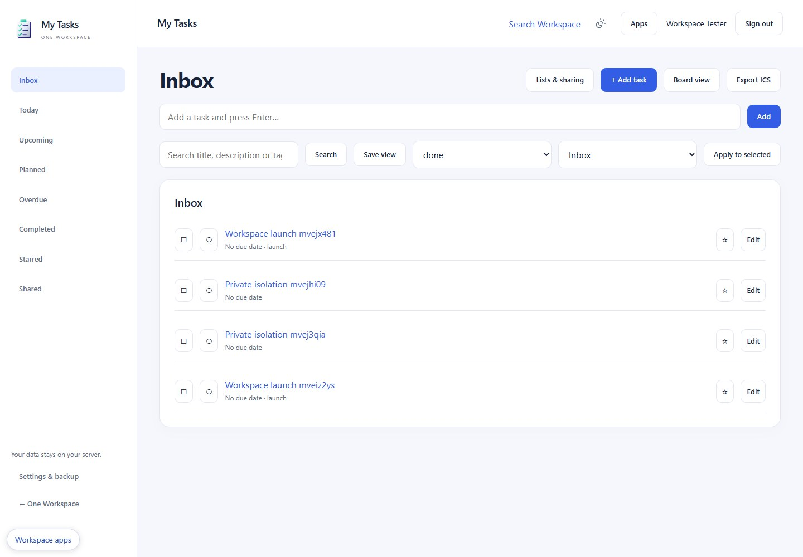

<p align="center"></p>

# My Tasks

Private and shared tasks, recurring plans and reminders. An original Apache-2.0 One Workspace application; not an upstream fork.



## Windows download

Download the Windows x64 ZIP from [Releases](https://github.com/oneworkspacestudio/my-tasks/releases). Verify SHA256SUMS.txt, extract to a program folder and run **MyTasks.exe**. No Docker, WSL, Node.js or Python is needed at runtime. A modern browser and a dedicated **NTFS** data folder are required. This is a **0.1.0-preview.1** release; unsigned Windows executables may prompt for trust.

The simplest managed installation is [One Workspace](https://github.com/oneworkspacestudio/one-workspace). New default apps are installed during manager updates unless explicitly excluded. Existing app data and user files are preserved.

## Included

Inbox, Today, Upcoming, Planned, Overdue, Completed, Starred and Shared; editable lists and board view; Markdown descriptions, tags, priorities and one-level subtasks; viewer/editor sharing; bounded daily/weekly/monthly/yearly recurrence with IANA time zones and exceptions; in-app reminder retries; explicit Calendar/Notes links; ICS export.

## Standalone

```powershell
.\MyTasks.exe --data C:\WorkspaceData\my-tasks --listen 127.0.0.1:8795
```

The app opens a one-time first-owner setup link. Choose your own password. Later starts reuse the same data folder. Keep private data separate from the executable and user-created files. Use a distinct port for each app. App Settings offers encrypted backup and account details; managed installations use MyAccounts automatically.

## Important limits

Editing the recurrence pattern of an existing series requires creating a new series. Calendar and Notes links do not create records. No full CalDAV VTODO or external email notification service is claimed. Drag reordering is limited to 100 loaded tasks.

See [operations and recovery](docs/OPERATIONS.md), [API contracts](docs/API.md), [acceptance evidence](docs/ACCEPTANCE.md), [architecture](docs/ARCHITECTURE.md) and [security](SECURITY.md). Preview status does not imply clean-machine, reboot, Windows-service or independent penetration-test certification.

## Build locally

Install PowerShell 7, Go 1.27.2 and Node.js 24+ for development only. Run `scripts/build.ps1 -Go <go.exe> -Npm <npm.cmd> -Release` from a clean committed checkout. The script uses pinned Go/npm dependencies, regenerates `.aui` UI, runs TypeScript, Go tests/vet and frontend contracts, builds the Windows icon/EXE, inventories dependency licenses and emits an immutable ZIP plus checksums. Browser tests: set APP_E2E_URL, APP_E2E_PASSWORD and run `npm run test:e2e` in web against disposable data.

No GitHub Actions are used. Distribution includes LICENSE, NOTICE, full dependency license texts, dependency inventory, compatibility and source build information. Source edits belong in `web/src/screens/*.aui`; generated React is reviewed and committed.
